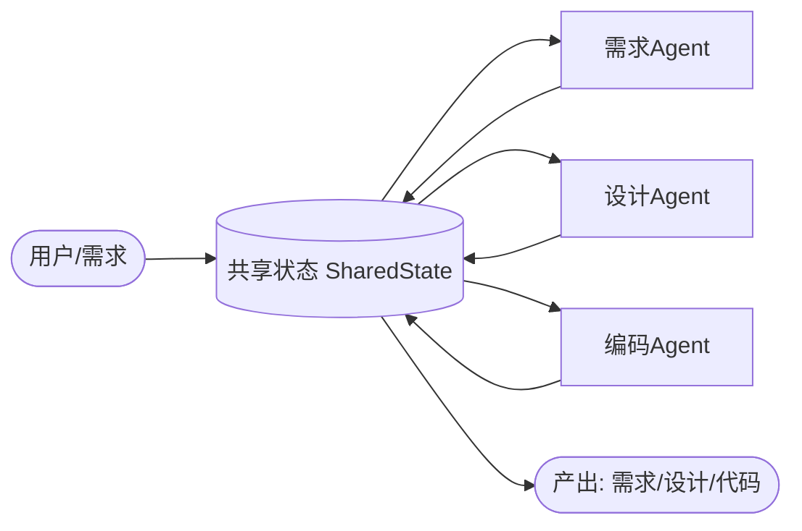

# Design.md — Homework 2 设计文档

> 软件工程课程作业 2：搭建一个 **3 个 Agent 协作**的简单 Workflow，理解 Workflow 编排、Agent 间通信与状态管理。
>
> 作者：宋泽轶　学号：2412190206

## 1. 项目概述

严格按照作业 PPT 的「Mini SE 流程」实现 **需求 → 设计 → 代码** 三个 Agent 顺序协作：

| 方向 | 流程描述 | Agent 组成 |
|------|----------|------------|
| **Mini SE 流程** ✅ | 需求 → 设计 → 代码 | 需求 Agent + 设计 Agent + 编码 Agent |

对应 PPT「技术要求」：
- 至少 2 个 Agent 协作完成完整流程 ✅（实际 3 个）
- Agent 间消息传递 / 状态共享 ✅
- 基本流程控制（顺序执行）✅
- MVP 可运行即可 ✅

## 2. 整体架构（Blackboard / 共享状态模式）

三个 Agent 不直接互相调用，而是通过一个**共享状态（黑板 Blackboard）**交换数据：
- 上游 Agent 把结果 `publish` 到共享状态；
- 下游 Agent 通过 `read` 获取上游产物，完成 **Agent 间信息互通**；
- `history` 记录完整通信链路，满足「执行日志与状态追踪」。

```
用户需求 ──▶ SharedState ──▶ 需求Agent ──▶ SharedState ──▶ 设计Agent ──▶ SharedState ──▶ 编码Agent ──▶ 产出
```

## 3. 流程图



## 4. 三个 Agent 设计

| Agent | 职责 | 输入 | 输出（写入共享状态 Key） |
|-------|------|------|--------------------------|
| 需求 Agent | 将用户需求标准化为软件需求文档 | 用户原始需求 | `requirement` |
| 设计 Agent | 基于需求产出技术设计（模块/接口/数据流） | 读取 `requirement` | `design` |
| 编码 Agent | 基于设计产出可运行代码骨架 | 读取 `design` | `code` |

- 每个 Agent 继承 `BaseAgent`，拥有 `system`（角色设定）与 `_build_prompt`（拼接上游上下文）。
- 真实生成由 `LLMClient` 完成；调用失败时自动降级为 `_mock` 模板，保证流程不中断。

## 5. 状态管理（SharedState）

`state.py` 提供：
- `publish(key, value, producer)`：写入产物并记录生产者；
- `read(key)`：读取产物；
- `history`：按时间记录「谁 → 哪个状态（多少字符）」的通信链。

这是 Agent 间**信息传递互通**的核心机制。

## 6. 技术选型（LLM 客户端）

`llm.py` 统一抽象调用层，内置 **mock / ollama / gemini / groq / siliconflow** 多种 provider。

- **默认采用国内可访问的免费平台「硅基流动 SiliconFlow」**（OpenAI 兼容、注册送免费额度），
  三个 Agent 分别使用其免费模型，实现「3 个免费 Agent 协作」。
- 若需离线/境外方案，可在 `main.py` 的 `build_agents()` 将 provider 改为 `ollama` / `gemini` / `groq`。
- 未配置 Key 时自动降级 `mock`，满足 PPT「MVP 可运行即可」。

## 7. 流程控制

`workflow.py` 的 `Workflow.run` 按 `agents` 列表**顺序**执行每个 Agent，每步把上游状态喂给下游，
实现端到端跑通。架构支持后续扩展为并行 / 条件分支（仅需修改编排逻辑）。

## 8. 可扩展性

- 新增 Agent：继承 `BaseAgent` 并实现 `system` / `_build_prompt` / `_mock`，加入 `Workflow.agents` 即可。
- 更换/新增引擎：在 `LLMClient` 增加 provider，无需改动 Agent 与编排代码。
- 修改流程：调整 `Workflow.run` 的执行顺序或加入分支/循环。

## 9. 对应 PPT 评审要点

| 评审维度 | 实现情况 |
|----------|----------|
| 流程完整性（40%） | Mini SE 流程端到端跑通：需求 → 设计 → 代码 |
| Agent 协作（30%） | 3 个 Agent 通过共享状态互通，`history` 记录通信链 |
| 可扩展性（20%） | 新增 Agent / 引擎 / 改流程均低成本 |
| 文档（10%） | README.md + 本 Design.md + 流程图 + TEST.md |

## 10. 运行方式

```bash
cd 提交物1_代码
pip install -r requirements.txt
python main.py          # 默认使用 SiliconFlow 真实模型（需 .env 中配置 Key）
python test_workflow.py # 自动化可行性测试（12/12，无需网络/Key）
```
