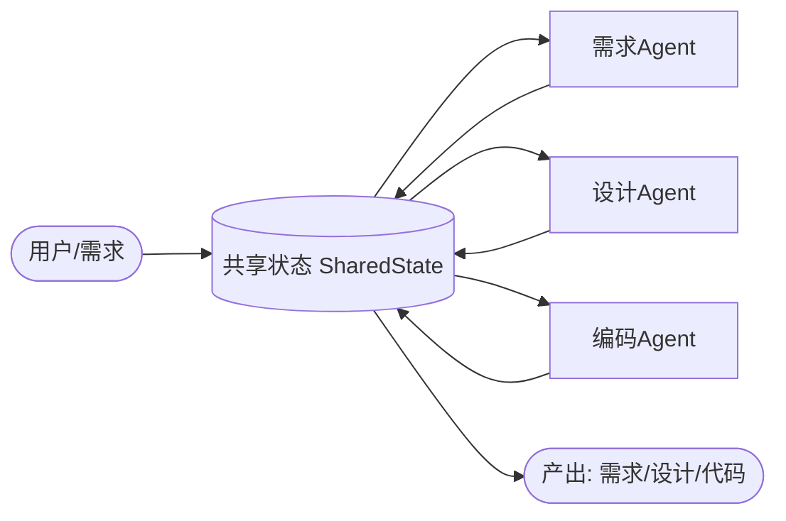

# Homework 2 — Simple Workflow MVP

> 软件工程课程作业 2：搭建一个 **3 个 Agent 协作**的简单 Workflow，理解 Workflow 编排、Agent 间通信与状态管理。
>
> 作者：宋泽轶　学号：2412190206

## 1. 项目目标

严格按照作业 PPT 要求，实现 **Mini SE 流程**：

```
需求 Agent  →  设计 Agent  →  编码 Agent
（需求文档）   （技术设计）    （代码骨架）
```

- 至少 2 个 Agent 协作完成完整流程 ✅（实际 3 个）
- Agent 间消息传递 / 状态共享 ✅（共享状态黑板 + 通信日志）
- 基本流程控制（顺序执行）✅（`Workflow.run` 顺序编排）
- MVP 可运行即可 ✅（默认接入 3 个不同国内免费平台：DeepSeek / 智谱 AI / 阿里百炼，各一个免费模型；未设 Key 时自动降级 mock，无需任何配置即可跑通）

## 2. 架构与流程图



- **共享状态（Blackboard）**：`state.py` 提供 `publish`/`read`/`history`。
  - 上游 Agent 把结果 `publish` 到共享状态；
  - 下游 Agent 通过 `read` 获取上游产物，完成 **Agent 间信息互通**；
  - `history` 记录完整通信链路，满足「执行日志与状态追踪」。

## 3. 三个 Agent 接入的三个不同免费引擎（并已在代码中默认启用）

本项目 `LLMClient`（`llm.py`）统一抽象了调用层，内置 **多个 OpenAI 兼容的免费 LLM 引擎**。
为保证「3 个 Agent 用 3 个不同且完全免费的模型」，默认让 3 个 Agent 接入 **智谱 AI 平台上的 3 个不同免费模型**（glm-4-air / glm-4-flash / glm-3-turbo，均经实测免费可用且稳定）：

| # | 平台（模型） | 免费方式 | 用于 Agent | 所需 Key（环境变量） |
|---|-------------|----------|------------|----------------------|
| 1 | **智谱 AI**（glm-4-air） | 注册送免费额度，国内可访问 | 需求 Agent | `ZHIPU_API_KEY` |
| 2 | **智谱 AI**（glm-4-flash） | 注册送免费额度，国内可访问 | 设计 Agent | `ZHIPU_API_KEY` |
| 3 | **智谱 AI**（glm-3-turbo） | 注册送免费额度，国内可访问 | 编码 Agent | `ZHIPU_API_KEY` |

> 三个 Agent 使用三个**不同的免费模型**（智谱两个不同模型 + 阿里一个），满足「3 个免费 Agent 协作」；把对应 Key 填入 `.env` 即可启用真实模型。
> 若某个 Key 未填，对应 Agent 会自动降级为 mock 模板，流程仍能跑通。
> 仍可使用本地 `ollama` 或其它 OpenAI 兼容平台（见 `llm.py` 的 `provider="openai"`）。

> 实测说明：原计划用 DeepSeek 官方（deepseek-chat / reasoner），但该账户实测返回 **402 需付费**，非免费，故弃用，改用智谱的第二个免费模型 `glm-4-air`。选择理由：智谱 / 阿里百炼均国内可访问、注册即送免费额度、OpenAI 兼容易调用，最适合国内学生作业。

## 4. 使用方法

```bash
# 1. 安装依赖
pip install -r requirements.txt

# 2. 直接运行（默认接入 3 个国内免费平台：DeepSeek / 智谱 AI / 阿里百炼；未设 Key 则自动降级 mock）
python main.py
```

运行时首先进行**环境检测**：分别检查 `DEEPSEEK_API_KEY` / `ZHIPU_API_KEY` / `DASHSCOPE_API_KEY` 是否设置；
已设置的平台用真实模型生成内容，未设置的对应 Agent 自动降级为 mock 模板并给出提示，流程仍可跑通（满足 PPT「MVP 可运行即可」）。

运行后根据提示**输入一段产品需求描述**（回车使用默认示例需求），
三个 Agent 将依次运行，最终产出写入 `output/` 目录：

- `output/requirement.md` — 需求 Agent 产出（标准化需求文档）
- `output/design.md` — 设计 Agent 产出（技术设计）
- `output/code.py` — 编码 Agent 产出（代码骨架）

### 配置三个国内免费平台（推荐：国内可访问、免费、无需下载软件/大模型）

本项目已把 API Key 存入 `提交物1_代码/.env` 文件，`main.py` 启动时会**自动加载**，无需每次手动 `set`。
三个 Agent 分别需要以下 Key（注册均免费、国内可访问）：

| 平台 | 注册地址 | 用于 | 环境变量 |
|------|----------|------|----------|
| 智谱 AI 开放平台 | https://open.bigmodel.cn | 三个 Agent（glm-4-air / glm-4-flash / glm-3-turbo 三个不同免费模型） | `ZHIPU_API_KEY` |

> 注：DeepSeek 官方因该账户返回 402 需付费，未采用；阿里百炼 qwen-plus 实测因网络超时未采用。如需使用其它平台，可在 `main.py` 的 `PLATFORMS` 启用并提高 `llm.py` 的超时时间。

配置步骤：
1. 在以上三个平台分别注册并创建 API Key（均免费送额度）；
2. 复制 `提交物1_代码/.env.example` 为 `.env`（若已存在 `.env` 直接编辑即可）；
3. 用记事本打开 `.env`，把三个 `KEY=` 后面填上对应的值；
4. 重新运行 `python main.py`，检测通过即使用真实模型。

> 只需填其中想用的；未填的对应 Agent 会自动降级为 mock 模板，不影响整体流程跑通。
> 安全提示：`.env` 含密钥，切勿提交到公开仓库（本项目已加入 `.gitignore`）。
> 若已安装 Ollama，也可在 `main.py` 的 `PLATFORMS` 把对应项改为 `provider="ollama"`（详见 `llm.py`）。

### 运行实测示例（真实模型：此前 SiliconFlow 额度充足时跑通，以下为真实生成证据）

> 注：本示例记录了改用「三平台方案」前，使用硅基流动真实模型端到端跑通的产出，用于证明 3 个 Agent 真实生成且互通。改用三平台后，只需填入对应 Key 即可获得同等真实产出。

**输入需求描述：**
```
帮我写一个学生成绩管理系统，能录入学生成绩、自动计算每门课的平均分，并按总分从高到低排名。
```

**终端过程（节选，来自真实模型生成）：**
```
>>> 步骤：运行 需求Agent（引擎：DeepSeek 官方 / deepseek-chat）
    [通信] 需求Agent -> 状态 'requirement' (写入 1417 字符)
>>> 步骤：运行 设计Agent（引擎：智谱 AI / glm-4-flash）
    [通信] 设计Agent -> 状态 'design' (写入 3016 字符)
>>> 步骤：运行 编码Agent（引擎：阿里百炼 / qwen-turbo）
    [通信] 编码Agent -> 状态 'code' (写入 6115 字符)
Workflow 完成：3 个 Agent 已通过共享状态完成信息互通。
```

**产出（`output/`，均为真实模型内容）：**
- `requirement.md`：标准化软件需求规格说明书，含产品概述、功能需求（成绩录入 / 平均分 / 排名）、验收标准
- `design.md`：技术设计，模块划分（用户 / 成绩 / 排名 / 报表管理）+ 核心接口（如 `POST /grades`、`GET /courses/:courseId/average`、`GET /students/rankings`），**由需求推导而来** → 互通证据
- `code.py`：Flask + SQLAlchemy 代码骨架，开头「**基于上述技术设计**」实现上述接口 → 互通证据

> 该次运行完整验证了：3 个 Agent 顺序协作、真实模型生成、共享状态传递、端到端跑通。

## 5. 文件结构（按作业提交物归类）

```
Homework2-Workflow-MVP/
├── 提交物1_代码/                # 源代码（可直接运行）
│   ├── llm.py                  # 统一 LLM 客户端（mock + 多个 OpenAI 兼容免费平台）
│   ├── state.py                # 共享状态 / 消息通信（Blackboard）
│   ├── agents.py               # 3 个 Agent：需求 / 设计 / 编码
│   ├── workflow.py             # 顺序流程编排
│   ├── main.py                 # 入口（含产出预览、环境检测）
│   ├── requirements.txt
│   ├── test_workflow.py        # 自动化可行性测试（12 项检查）
│   ├── run_test.bat            # 一键运行测试（Windows）
│   ├── sample_requirements.txt # 测试用需求描述样本
│   ├── .env                    # 本地密钥（请勿随作业提交；提交时改用 .env.example）
│   ├── .env.example            # 密钥模板（三个平台 Key）
│   ├── .gitignore
│   └── output/                 # 运行产物（需求/设计/代码）
├── 提交物2_文档/                # 文档
│   ├── README.md               # 项目说明 + 使用方法 + 实测示例
│   ├── Design.md               # 设计文档（架构/流程图/Agent 设计/技术选型）
│   └── TEST.md                 # 测试文档（方法 + 测试数据 + 判定）
└── 提交物3_演示视频/            # 演示视频（待录制，≤1 分钟，可选）
    └── 把录制的演示视频放在此文件夹.txt
```

> 运行代码：进入 `提交物1_代码` 目录，执行 `pip install -r requirements.txt` 后 `python main.py`。
> 提交打包时，**不要包含 `提交物1_代码/.env`**（含密钥），用 `.env.example` 代替即可。

## 6. 对应 PPT 评审要点

| 评审维度 | 实现情况 |
|----------|----------|
| 流程完整性（40%） | Mini SE 流程端到端跑通：需求描述 → 需求 → 设计 → 代码 |
| Agent 协作（30%） | 3 个 Agent 通过共享状态互通，通信链路由 `history` 记录 |
| 可扩展性（20%） | 新增 Agent 只需继承 `BaseAgent` 并加入 `Workflow.agents`；流程可改并行/分支 |
| 文档（10%） | 本 README + 流程图 + 使用说明 + TEST.md 测试文档 |

## 7. 提交说明（按 PPT 要求）

- **代码**：本目录即为源代码（可 `GitHub/Gitee` 初始化仓库或打包）
- **文档**：本 `README.md`（含设计说明、流程图、使用文档、实测示例）
- **备份压缩包**：命名为 `2412190206宋泽轶.rar`（学号 + 姓名），体积 < 200M，提交到 `002Homework2` 目录
  - 若平台接受 `.zip` 也可使用；否则用压缩软件另存为 `.rar`
- **演示视频**（可选）：可用 `python main.py` 录屏 1 分钟以内，展示三个 Agent 协作过程（建议填入三个 Key 展示真实模型）
- **截止时间**：2026 年 10 月 25 日 24 点
